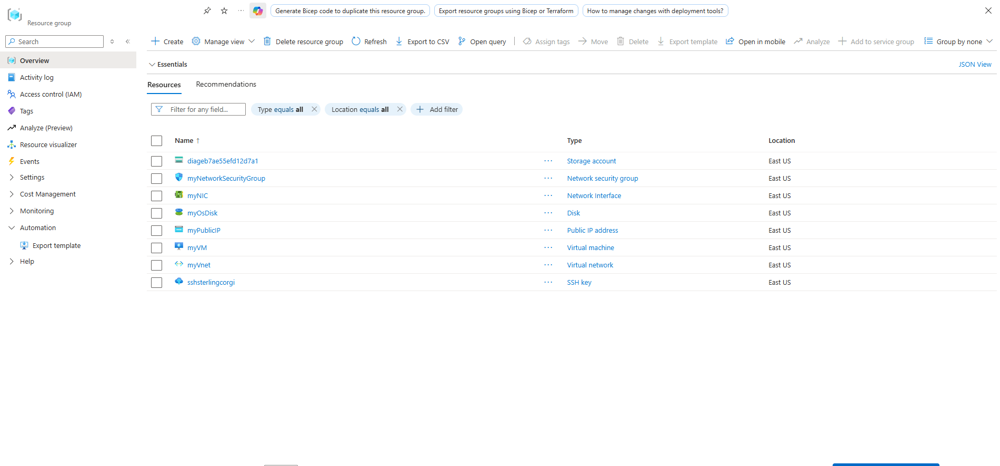
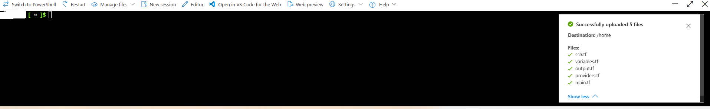
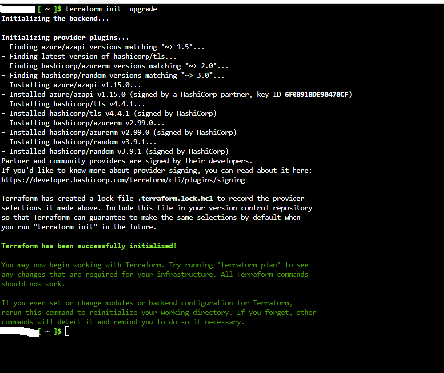
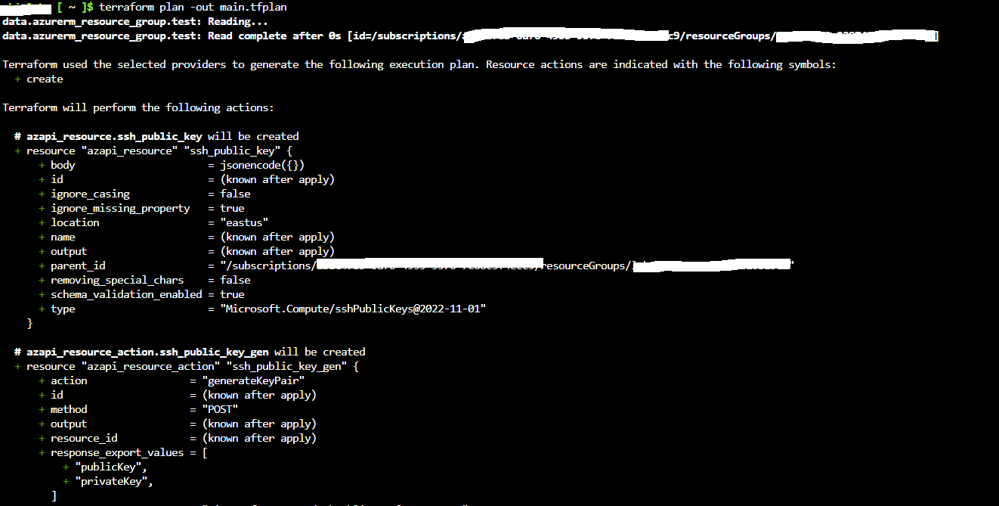
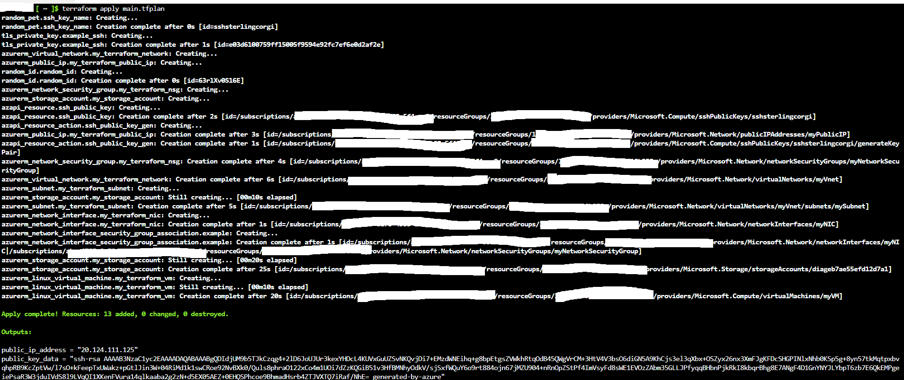

# Deploying an Azure Virtual Network and Linux Virtual Machine with Terraform

Comprehensive infrastructure provisioning details covering the architecture, configuration, and deployment of an Azure Virtual Network, Subnet, Public IP, Network Security Group, Storage Account, SSH Key, and Linux Virtual Machine using Terraform.

---

## 1. Architecture & Provisioned Resources

### Core Infrastructure Topology

| Resource Type | Resource Name | Specification / Tier | Region / Location |
| :--- | :--- | :--- | :--- |
| **Virtual Network** | `myVnet` | `10.0.0.0/16` Address Space | East US |
| **Subnet** | `mySubnet` | `10.0.1.0/24` Address Prefix | East US |
| **Public IP** | `myPublicIP` | Dynamic IPv4 Allocation (`20.124.111.125`) | East US |
| **Network Security Group** | `myNetworkSecurityGroup` | Inbound SSH Rule (Port 22, Priority 1001) | East US |
| **Storage Account** | `diageb7ae55efd12d7a1` | Standard_LRS, Boot Diagnostics | East US |
| **Linux Virtual Machine** | `myVM` | Standard_B2s, Ubuntu 22.04-lts-gen2 | East US |

---

### Provisioned Environment Validation

*Resource group overview confirming successful deployment of the virtual machine, virtual network, public IP, network security group, network interface, storage account, and SSH key.*

---

## 2. Step-by-Step Implementation

### Step 1: Upload Configuration Files

Uploaded all required Terraform configuration files (`main.tf`, `variables.tf`, `output.tf`, `providers.tf`, and `ssh.tf`) into the workspace environment.

*Confirmation displaying the successful upload of the five Terraform configuration files.*

---

### Step 2: Initialize Terraform

Initialized the working directory and downloaded the required provider plugins (`azurerm`, `azapi`, and `random`) using Terraform initialization.

*Initializing provider plugins and backend settings.*

---

### Step 3: Generate Terraform Execution Plan

Created an execution plan to preview the resource actions required to build the infrastructure in the designated Azure resource group.

*Executing the planning stage to review resource creation actions.*

---

### Step 4: Apply Terraform Configuration

Executed the deployment plan to provision all declared cloud resources, generating the SSH key pair and deploying the Linux virtual machine.

*Applying the configuration to provision the virtual machine and related infrastructure components.*

---

### Step 5: Verify Infrastructure Deployment via Outputs

Retrieved the provisioned virtual machine's public IP address using the Terraform output command.

*Verifying the output of the deployed public IP address.*
